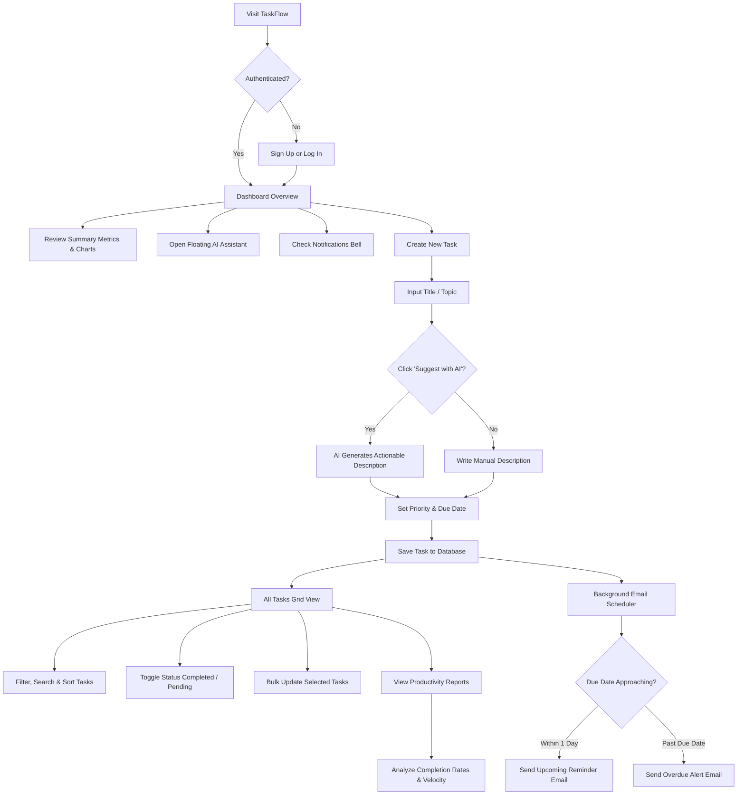

# TaskFlow — Comprehensive Project Overview & Portfolio Documentation

> **Plan · Track · Complete**  
> An intelligent, full-stack productivity and task management SaaS application engineered with Django, Groq AI, and automated SMTP notifications.

---

## 1. Project Introduction

### Project Name & Overview
**TaskFlow** is a modern, full-stack personal productivity and task management web application designed to help individuals and professionals organize workflows, meet deadlines, and maximize efficiency. Built on the robust **Django Model-View-Template (MVT)** architecture, TaskFlow integrates real-time productivity analytics, responsive modal-based task interactions, automated due-date email reminders, and an intelligent **Groq Cloud AI Assistant** that provides actionable advice, instant task description generation, and structured technology learning roadmaps.

### What Problem Does TaskFlow Solve?
Modern professionals, software developers, and students constantly face information overload, fragmented to-do lists, and missed deadlines. Traditional task managers often suffer from:
1. **Passive lists:** Standard to-do apps act as simple digital scratchpads that do not actively assist users in clarifying vague task objectives.
2. **Missed deadlines:** Users forget to check task boards until deadlines have already passed, lacking proactive, automated notification triggers.
3. **Fragmented analytics:** Most personal task tools lack clear, database-backed visual summaries showing completion rates, priority distributions, and weekly velocity.
4. **Vague task definitions:** Users often write ambiguous goals (e.g., *"Learn Django"* or *"Fix bug"*), creating psychological friction and procrastination due to a lack of actionable steps.

TaskFlow solves these issues by pairing intuitive CRUD workflows and visual analytics with an **automated email alert system** and an **embedded Groq AI productivity mentor**. TaskFlow transforms ambiguous goals into concise, concrete tasks with a single click, alerts users before deadlines arrive, and provides visual velocity tracking across their workload.

### Why Did I Develop TaskFlow?
TaskFlow was developed as a production-grade, portfolio-defining full-stack web application demonstrating:
- End-to-end mastery of **Python** and the **Django Framework** (authentication, ORM query optimization, custom management commands, background daemon threading).
- Seamless **Third-Party API Integration** with Groq's high-speed LLM inference engine.
- Production-ready **SMTP Email Automation** featuring dual HTML/plain-text rendering and state-based duplicate prevention.
- Modern **Frontend Engineering** utilizing custom CSS design systems (Emerald-Mint SaaS palette), vanilla JavaScript ES6+ AJAX workflows, and Chart.js analytics without relying on heavy frontend frameworks.
- Clean adherence to web security standards: user-scoped database isolation, CSRF protection, PBKDF2 password encryption, and multi-layer file upload verification.

### Who Benefits From TaskFlow?
- **Software Engineers & Technical Leads:** Track development sprints, architectural refactoring, bug fixes, and generate structured roadmaps for learning new programming languages or frameworks.
- **Students & Self-Learners:** Structure study sessions, decompose complex syllabi into actionable exercises, and stay on schedule with automated reminders.
- **Freelancers & Solopreneurs:** Manage client deliverables, monitor project priorities, and maintain accountability through visual completion ratios.
- **General Productivity Seekers:** Anyone looking for an elegant, distraction-free dashboard to organize daily routines, track deadlines, and eliminate mental clutter.

---

## 2. Project Objectives

1. **Streamline Daily Workflow Management:** Provide an instantaneous, zero-clutter interface to capture, organize, prioritize, and complete tasks with minimal clicks.
2. **Deliver Actionable AI Productivity:** Go beyond generic chatbots by integrating task-specific AI that instantly generates concise, practical task descriptions and 3-level learning roadmaps.
3. **Proactive Deadline Accountability:** Ensure users never miss a due date by combining an in-app interactive notification center with automated background SMTP email reminders for upcoming and overdue tasks.
4. **Data-Driven Self-Reflection:** Provide real-time productivity metrics—including total task counts, completion percentages, priority breakdowns, and 7-day creation velocity graphs.
5. **Absolute Privacy & Data Isolation:** Ensure every user's tasks, notes, and activity logs remain strictly confidential through rigorous user-level ORM query scoping.

---

## 3. Technology Stack

| Layer / Subsystem | Technology | Version / Spec | Why It Was Chosen |
|---|---|---|---|
| **Backend Framework** | Python & Django | Python 3.13 / Django 5.1.3 | Industry standard for secure, maintainable, batteries-included web applications. Provides built-in ORM, robust authentication, session management, and CSRF protection. |
| **Database** | SQLite (Development / Demo) | SQLite 3 via Django ORM | Lightweight, zero-configuration relational database ideal for development and isolated environments. Fully abstracted via Django ORM for seamless PostgreSQL / MySQL migration in production. |
| **AI Integration** | Groq Cloud API | REST API / Model: `openai/gpt-oss-20b` | High-throughput, low-latency LLM inference. Enables near-instantaneous responses for interactive chat and task suggestion workflows. |
| **Email Automation** | Gmail SMTP / Python `smtplib` | Port 587 (TLS) / `EmailMultiAlternatives` | Reliable transactional email delivery with zero external infrastructure overhead (no Redis/Celery required for basic deployments). Generates dual-format HTML and plain-text emails. |
| **Frontend Styling** | Custom CSS3 + Bootstrap 5 | Bootstrap 5.3 Grid + Custom Theme Tokens | Modern SaaS aesthetic featuring a custom emerald green gradient palette (`#047857`, `#065F46`, `#34D399`), custom CSS variables, and full responsiveness across mobile, tablet, and desktop screens. |
| **Frontend Icons** | Bootstrap Icons | Version 1.11.3 | Crisp, lightweight SVG-based icon system used consistently across the sidebar, navigation, task cards, badges, and modals. |
| **Data Visualization** | Chart.js | Version 4.4.1 (UMD) | High-performance, canvas-based charting library used to render interactive doughnut charts, bar charts, and smooth weekly line graphs. |
| **Client-Side Scripting** | Vanilla JavaScript (ES6+) | Modern DOM APIs & `fetch()` | Lightweight, framework-free client interactions: asynchronous modal form submissions, inline task status toggles, real-time character counters, and chat message streaming. |
| **Image Processing** | Pillow (PIL) | Version 10.0+ | Server-side image format validation, binary header verification, and avatar handling to prevent malicious file uploads. |
| **Configuration** | `python-dotenv` | Version 1.0.1 | Strict 12-Factor App compliance: all API keys, SMTP credentials, and security secrets reside securely in `.env` outside the version control tree. |

---

## 4. Complete Module Overview

### 1. User Authentication & Authorization (`accounts` app)
- **What It Does:** Manages secure user onboarding, authentication, session state, and access controls.
- **How It Works:** 
  - **Signup:** Custom `SignupForm` capturing full name, email, optional username, and password with standard Django validation. Automatically provisions an associated `Profile` record upon creation.
  - **Login:** Custom `LoginForm` allowing case-insensitive login using **either** email address or username, with optional "Remember Me" session persistence.
  - **Logout:** Secure POST-based logout terminating sessions and clearing cookies.
- **Key Benefits:** Frictionless onboarding, dual-identifier login convenience, and robust PBKDF2 password hashing.
- **Special Functionality:** Automatically synthesizes a clean username from the user's email if omitted during registration.

### 2. Main Productivity Dashboard (`tasks:dashboard`)
- **What It Does:** Acts as the central executive mission control for the user's daily productivity.
- **How It Works:** 
  - Displays four instant metric cards: **Total Tasks**, **Completed**, **Pending**, and **Overdue**.
  - Renders an interactive **Task Overview Donut Chart** displaying status proportions with a center-mounted completion percentage.
  - Renders a **This Week Activity Chart** showing daily task creation velocity over the last 7 days.
  - Displays a **Recent Tasks Table** with one-click completion checkboxes, priority badges, and quick-action edit/delete triggers.
  - Houses the **AI Task Suggestion Card** providing an entry point to the AI assistant.
- **Key Benefits:** Gives users immediate clarity on their current workload and overdue priorities within 3 seconds of logging in.

### 3. Task Management (CRUD) (`tasks` app)
- **What It Does:** Complete lifecycle management for individual tasks.
- **How It Works:** 
  - **Create:** Modal-based form with Title (required, 200 char limit), Description (optional, 2000 char limit), Priority (`Low`, `Medium`, `High`), and Due Date (optional HTML5 date picker). Supports both AJAX submission and standard POST fallback.
  - **Read:** Paginated table view (10 tasks per page) with search query matching and sorting.
  - **Update:** Pre-fills modal via AJAX GET, updates database record via AJAX POST without page reload.
  - **Delete:** Two-step confirmation modal with task title display to prevent accidental deletions.
  - **Toggle:** Instantaneous AJAX checkbox toggle updating the task status between `Pending` and `Completed` in real time with strike-through styling.
- **Key Benefits:** Zero-latency interaction—users can add, edit, or check off tasks without full page reloads.

### 4. All Tasks Management View (`tasks:task_list`)
- **What It Does:** An enterprise-style data table designed for deep task search, multi-factor filtering, and batch updates.
- **Special Functionality:**
  - **Live Filter Pills:** Instant tab switching between `All`, `Pending`, `Completed`, and `Overdue` with dynamic count badges.
  - **Priority Filtering:** Dropdown filter isolating `High`, `Medium`, or `Low` priority items.
  - **Keyword Search:** Real-time search across task titles and descriptions.
  - **Bulk Toggle:** "Select All" checkbox allowing users to mark entire pages of tasks as completed or pending simultaneously.
  - **Click-to-Expand Descriptions:** Truncated table cells expand smoothly when clicked, showing long descriptions without breaking table alignment.
  - **Sticky Header & Fixed Viewport:** Desktop view locks scrolling to the table container, keeping pagination and navigation visible at all times.

### 5. Task Priority & Status Classification
- **Priorities:** `High` (Crimson badge), `Medium` (Amber badge), `Low` (Emerald badge).
- **Status Classification:**
  - **Completed:** Task marked complete (`completed = True`). Overdue conditions are automatically silenced.
  - **Pending:** Task not yet completed (`completed = False`).
  - **Overdue:** Pending task whose `due_date` is strictly prior to today's date. Highlighted in red with warning icons across tables, dashboards, and notification modals.
  - **Due Today:** Pending task whose `due_date` matches today's date. Highlighted with urgent status labels.
  - **Upcoming:** Pending task scheduled for future dates.

### 6. Reports & Analytics (`reports` app)
- **What It Does:** Comprehensive productivity intelligence and historical trend analysis.
- **Visual Analytics:**
  - **Status Distribution Donut:** Visual breakdown of Completed vs. Pending vs. Overdue items.
  - **Priority Breakdown Bar Chart:** Visualizes distribution across High, Medium, and Low priorities.
  - **7-Day Velocity Line Chart:** Tracks productivity momentum and task creation over the previous week.
  - **Curated Task Feeds:** Quick-glance lists showing *Recently Completed*, *Pending Tasks*, and *High Priority Items*.
- **Key Benefits:** Helps users identify bottlenecks, spot overdue patterns, and maintain steady output.

### 7. User Profile Management (`accounts:profile`)
- **What It Does:** Allows users to personalize their account, configure avatars, and update credentials.
- **Features:**
  - **Profile Picture Upload:** Custom image upload supporting JPEG, PNG, WEBP, and GIF formats (up to 5MB).
  - **Binary Image Security:** Validates binary image headers via Pillow (`PIL.Image.open().verify()`) and saves files under randomized UUID filenames.
  - **Initials Fallback:** Dynamic two-letter gradient avatar generated automatically if no photo is uploaded.
  - **One-Click Photo Removal:** Instantly deletes the avatar file from media storage and restores the initials avatar.
  - **Information Update:** Edit first name, last name, and registered email address with uniqueness validation.

### 8. Password Management (`accounts:profile`)
- **What It Does:** Enables authenticated users to update their login credentials securely.
- **Security Logic:** Enforces current password verification, new password confirmation matching, and Django's built-in password complexity validators (minimum length, non-numeric, attribute similarity).
- **Session Protection:** Calls `update_session_auth_hash(request, user)` upon successful update so the user is not unexpectedly logged out of their current session.

### 9. Interactive Notification System (`includes/notification_modal.html`)
- **What It Does:** Real-time in-app notification center accessible from any page via the topbar bell icon.
- **How It Works:**
  - Topbar bell icon dynamically queries `/tasks/notifications/` via AJAX.
  - Displays a red indicator dot if pending tasks with due dates exist.
  - Clicking the bell opens an elegant modal displaying all pending tasks categorized into:
    - 🚨 **Overdue** (sorted first, highlighted in red)
    - 📅 **Due Today** (highlighted in emerald)
    - ⏰ **Upcoming** (sorted chronologically by due date)
  - If no pending tasks remain, displays an encouraging *"You're all caught up!"* empty state.

### 10. Automated Background Email Notifications (`tasks/email_scheduler.py`)
- **What It Does:** Proactively sends automated email reminders directly to users' inboxes without requiring them to be logged into the app.
- **Email Types:**
  - **Upcoming Task Reminder:** Consolidated HTML email sent when pending tasks approach their due date (configurable via `TASK_REMINDER_DAYS_BEFORE_DUE`, default: 1 day).
  - **Overdue Task Alert:** Dedicated email alert notifying users the moment a task passes its deadline.
- **Architectural Highlights:**
  - **Duplicate Prevention:** Tracks `upcoming_reminder_sent` and `overdue_alert_sent` boolean flags and timestamps in the database. Notifications are never sent twice for the same deadline.
  - **Auto-Reset Mechanism:** If a user reschedules an overdue task to a future date, the notification flags automatically reset, allowing future reminders.
  - **Background Daemon Thread:** Runs a lightweight background scheduler thread initialized during server startup, checking tasks at configurable intervals (e.g., every 3600 seconds) without external dependencies.
  - **CLI Command:** Provides `python manage.py send_task_reminders [--daemon]` for production cron triggers.

### 11. Floating Groq AI Assistant (`ai` package & `assistant` app)
- **What It Does:** An omnipresent, expandable chat assistant widget powered by Groq Cloud's ultra-fast LLM inference.
- **Interaction Style:** Practical, direct, and structured. Follows custom markdown system instructions stored in `ai/ai_instructions.md`.
- **Capabilities:**
  - Clarifies tasks and recommends execution steps.
  - Analyzes workload priorities based on the user's live task metrics.
  - Answers technical, coding, and architecture questions with concrete examples.
  - Full client-side Markdown rendering (bullet points, numbered lists, code blocks, bold headings).

### 12. AI-Powered Task Suggestions ("Suggest with AI")
- **What It Does:** Converts vague titles or single keywords into well-scoped, professional task descriptions.
- **How It Works:** 
  - Located directly inside the Create and Edit Task modals.
  - When a user enters a topic (e.g. *"React Hooks"* or *"Prepare tax report"*) and clicks **Suggest with AI**, the frontend queries `/assistant/suggest/`.
  - The Groq AI engine synthesizes a concise, 15–30 word actionable description (e.g. *"Build an interactive React counter component utilizing useState and useEffect hooks to manage state and side effects."*).
  - The suggested description automatically populates the form textarea.

### 13. Technology-Specific Learning Roadmaps
- **What It Does:** Built-in AI capability that synthesizes structured 3-level learning roadmaps for any technical skill or framework.
- **Structure:** Generates sequential **Beginner**, **Intermediate**, and **Advanced** milestones complete with recommended exercises, mini-projects, and expected outcomes.
- **Delivery:** Available directly through the floating AI Assistant chat interface.

---

## 5. Special Features & Highlights

```
+-----------------------------------------------------------------------------------------+
|                                    TASKFLOW HIGHLIGHTS                                  |
+------------------------------------+----------------------------------------------------+
| ⚡ Groq Cloud AI Integration        | High-speed LLM inference delivering instant chat   |
|                                    | responses and actionable task suggestions.         |
+------------------------------------+----------------------------------------------------+
| ✉️ Dual-Alert Email Automation     | Automated upcoming reminders & overdue alerts via  |
|                                    | Gmail SMTP with stateful duplicate prevention.     |
+------------------------------------+----------------------------------------------------+
| 🔔 Real-Time Notification Modal    | Categorized view (Overdue, Due Today, Upcoming)    |
|                                    | accessible with a single click from the topbar.    |
+------------------------------------+----------------------------------------------------+
| 🎨 Premium Emerald Design System   | Bespoke SaaS color palette with soft off-white     |
|                                    | backgrounds and mint-green accents.                |
+------------------------------------+----------------------------------------------------+
| 📊 Interactive Chart.js Analytics  | Real-time doughnut charts, priority bars, and      |
|                                    | 7-day velocity line graphs.                        |
+------------------------------------+----------------------------------------------------+
| 🔒 Strict User Data Privacy        | Zero data leakage—all queries strictly scoped to   |
|                                    | the authenticated user's primary key.             |
+------------------------------------+----------------------------------------------------+
| 📱 Fully Responsive Layout         | Mobile off-canvas drawer navigation, responsive    |
|                                    | tables, and adaptive touch-friendly cards.         |
+------------------------------------+----------------------------------------------------+
```

---

## 6. User Benefits & Value Proposition

1. **Eliminates Goal Ambiguity:** The "Suggest with AI" feature transforms vague intentions into tangible, executable tasks in seconds.
2. **Eliminates Deadlines Falling Through Cracks:** Proactive email alerts and notification badges ensure critical tasks are never forgotten.
3. **Reduces Cognitive Load:** Intuitive sorting, priority tags, and clean visual status pills help users focus solely on high-impact objectives.
4. **Boosts Long-Term Productivity:** Weekly activity charts and completion percentage rings provide visual gratification and encourage steady momentum.
5. **Accelerates Skill Acquisition:** Built-in learning roadmap generation allows developers and students to rapidly break down unfamiliar technologies into actionable study plans.

---

## 7. Complete Application User Journey



---

## 8. Security & Data Integrity

1. **User Isolation (Zero IDOR):** All task queries and mutations enforce `user=request.user`. Attempting to access or modify another user's task ID yields an immediate HTTP 404 response.
2. **CSRF Protection:** Every POST endpoint enforces Django's `CsrfViewMiddleware` and `@csrf_protect` decorator. Asynchronous requests supply CSRF tokens via request headers.
3. **Credential Protection:** Secrets (`SECRET_KEY`, `GROQ_API_KEY`, `EMAIL_HOST_PASSWORD`) are loaded strictly from the `.env` environment file. Logging routines mask API keys before outputting to logs.
4. **Binary Upload Validation:** Avatars undergo extension checks (`.jpg`, `.jpeg`, `.png`, `.webp`, `.gif`), file-size verification (max 5MB), and binary header inspection via `PIL.Image.open().verify()` to neutralize malicious code execution.
5. **Form Data Sanitization:** Strict CharField length constraints, input trimming, and HTML entity escaping (`escapeHtml()`) eliminate Cross-Site Scripting (XSS) risks.

---

## 9. Technical Highlights for Recruiters & Hiring Managers

TaskFlow demonstrates comprehensive proficiency across the full spectrum of modern web engineering:

- **Clean Backend Architecture:** Structured modular design separating concerns across `accounts`, `tasks`, `reports`, `assistant`, and `ai` packages.
- **Relational Modeling & ORM Mastery:** Complex query aggregation, date filtering (`due_date__lt=today`), foreign key relationships, cascade behaviors, and custom save logic for notification flag resets.
- **Asynchronous User Experience:** Rich, single-page-like responsiveness achieved via Vanilla JS `fetch()` endpoints returning structured JSON without heavy SPA overhead.
- **Third-Party API Integration:** Robust HTTP communication with Groq's LLM endpoints featuring timeout safety, error wrapping, and dynamic system prompt generation.
- **Multithreaded Background Services:** Custom in-process daemon threading (`threading.Thread`, `threading.Lock`) with process-level reloader guards for automated background task scheduling.
- **Modern UI / UX Execution:** Bespoke CSS design tokens, responsive CSS Grid/Flexbox layouts, interactive SVG icons, and accessible modal dialogs.

---

## 10. Future Roadmap & Planned Enhancements

| Feature | Category | Description | Status |
|---|---|---|---|
| **Subtasks & Checklists** | Core Task Management | Ability to break complex tasks into smaller sub-items with individual check states. | *Planned* |
| **Interactive Calendar View** | Visualization | Drag-and-drop monthly and weekly calendar interface for visual scheduling. | *Planned* |
| **Team Workspaces & Sharing** | Collaboration | Multi-tenant organization accounts with task assignment, role-based permissions, and team comments. | *Planned* |
| **Celery & Redis Worker Queue** | Infrastructure | Migration of background email scheduling to an external Celery worker pool for multi-server deployments. | *Planned* |
| **Push Notifications (PWA)** | Mobile / Notifications | Progressive Web App support with service-worker Web Push notifications directly to smartphones and desktops. | *Planned* |
| **Export Reports to PDF / CSV** | Analytics | One-click export of task audit trails and productivity reports for client reporting. | *Planned* |

---

## 11. Conclusion

TaskFlow represents a modern, thoughtfully engineered solution to personal task management and workflow productivity. By harmonizing robust backend architecture, data-driven visual reporting, automated deadline reminders, and actionable Groq AI capabilities into a responsive SaaS interface, TaskFlow bridges the gap between passive to-do lists and intelligent digital productivity assistants.

---

## 12. LinkedIn-Ready Project Presentation

### Short Project Blurb
> *Excited to unveil **TaskFlow** — an intelligent, full-stack productivity & task management SaaS platform engineered with Python, Django 5, Groq Cloud AI, and automated SMTP notifications! TaskFlow transforms vague goals into actionable plans, keeps deadlines on track with proactive email reminders, and visualizes productivity velocity through real-time analytics.*

### Comprehensive LinkedIn Project Post
```text
🚀 Excited to share my latest full-stack project: TaskFlow — Plan · Track · Complete!

Most task management tools act like passive digital scratchpads. They don't help you define vague goals, and they don't notify you until it's too late. 

I built TaskFlow to change that. It is a full-featured productivity SaaS that combines the stability of Django with the high-speed inference of Groq AI and automated deadline reminders.

💡 Key Highlights:
✨ AI Productivity Assistant: Powered by Groq Cloud (openai/gpt-oss-20b), TaskFlow features an interactive floating mentor and a one-click "Suggest with AI" tool that turns ambiguous topics into crisp, actionable 20-word tasks.
✉️ Automated Email Notifications: Integrated Gmail SMTP service running a background scheduler that alerts users about approaching due dates and overdue tasks with zero duplicate spam.
📊 Real-Time Analytics Dashboard: Interactive doughnut charts, 7-day velocity line graphs, and priority breakdowns built with Chart.js.
🔔 In-App Notification Center: Dynamic modal categorizing pending tasks into Overdue, Due Today, and Upcoming with live header indicator badges.
🔒 Robust Security: 100% user-scoped ORM data isolation, CSRF protection, PBKDF2 password hashing, and multi-tier binary avatar validation using Pillow.
🎨 Bespoke Emerald SaaS UI: Clean, modern responsive interface crafted with custom CSS variables, Bootstrap 5, and vanilla JavaScript AJAX workflows.

🛠️ Tech Stack: Python, Django 5, Groq API, SQLite/PostgreSQL, Chart.js, HTML5/CSS3, Bootstrap 5, Vanilla JS (ES6+), Pillow, python-dotenv.

Check out the full repository and architecture documentation here: [Your GitHub Link]

#Django #Python #FullStack #WebDevelopment #AI #Groq #Productivity #SoftwareEngineering #Portfolio #OpenSource
```

### Relevant Technical Skills
`Python` • `Django Framework` • `Django ORM` • `Groq Cloud AI API` • `RESTful Architecture` • `Email Automation (SMTP)` • `JavaScript (ES6+)` • `Chart.js` • `Bootstrap 5` • `CSS3 Variables & Responsive Design` • `Web Security & CSRF` • `Pillow (PIL)` • `Git & GitHub`

### Suggested Hashtags
`#Python` `#Django` `#WebDevelopment` `#FullStackDevelopment` `#SoftwareEngineering` `#GroqAI` `#SaaS` `#Productivity` `#PortfolioProject` `#BackendDeveloper`

