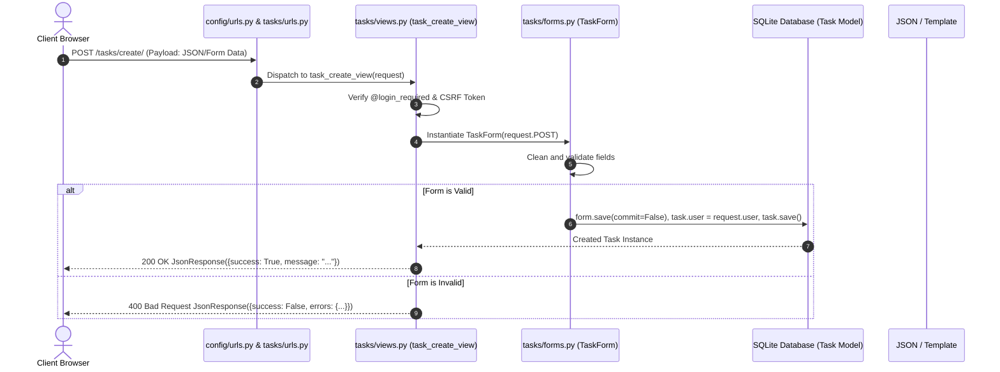
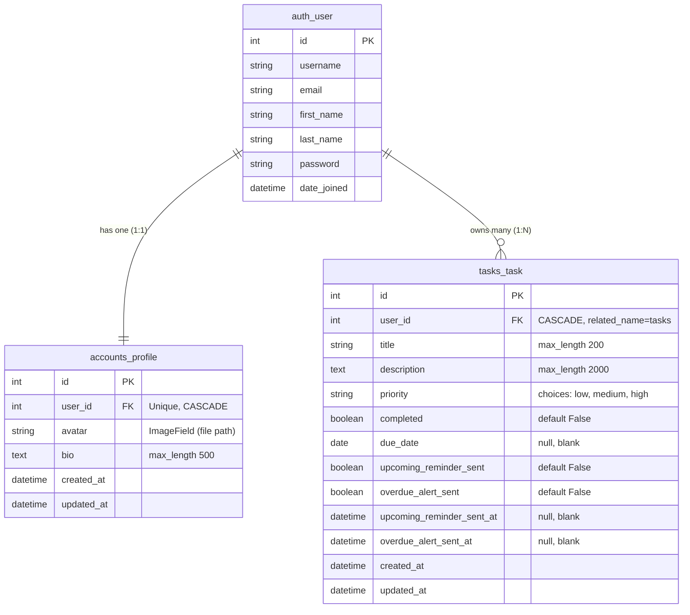
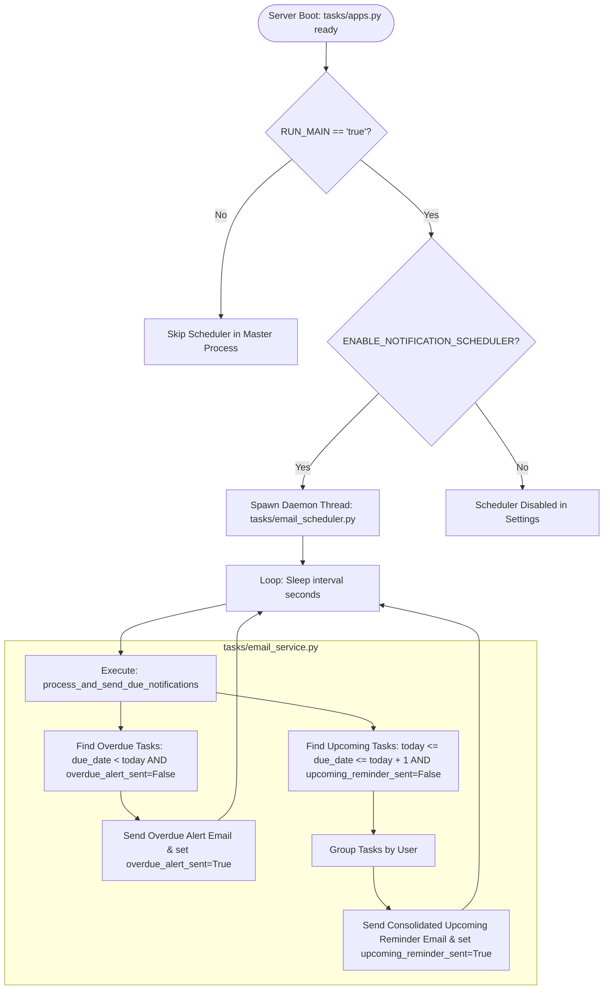

# TaskFlow — Comprehensive Technical Documentation & Architecture Reference

> **System Version:** 1.0.0  
> **Framework:** Django 5.1.3 (Python 3.13)  
> **Target Audience:** Maintainers, Developers, and AI Coding Assistants  
> **Last Updated:** November 3, 2026  

---

## 1. Technical Project Overview

TaskFlow is a monolithic web application built following the **Django Model-View-Template (MVT)** architectural pattern, augmented with lightweight asynchronous JavaScript (ES6+ AJAX) for dynamic front-end interactions. It provides a full-featured productivity dashboard, task management with multi-criteria filtering, automated email reminders, and Groq-powered generative AI assistance.

### Key Architectural Invariants
1. **Monolithic Modularity:** Applications are decoupled into dedicated domains (`accounts`, `tasks`, `reports`, `assistant`, `ai`), adhering to Django's reusable app convention.
2. **Dual Response Model:** Views support traditional HTML rendering for full page navigation and structured JSON responses (`JsonResponse`) when queried with an `X-Requested-With: XMLHttpRequest` header.
3. **Strict User-Data Partitioning:** Every database read, write, update, and delete operation is explicitly scoped to `request.user`. No multi-tenant data leakage or Insecure Direct Object References (IDOR) can occur.
4. **Environment Isolation:** Configuration parameters, third-party credentials, and database settings are strictly externalized via `python-dotenv` and loaded through `config/settings.py`.
5. **Lightweight Concurrency:** Background operations (e.g., periodic email checks) are handled via a managed in-process Python daemon thread or dedicated CLI management commands, avoiding mandatory dependencies on Redis or Celery for basic standalone deployments.

### Application Entry Points
- **HTTP Web Server (WSGI):** `config/wsgi.py` exposes the standard WSGI callable for production deployments (e.g., Gunicorn, uWSGI).
- **Asynchronous Server (ASGI):** `config/asgi.py` provides the ASGI callable for ASGI-compatible web servers.
- **Administrative CLI:** `manage.py` serves as the command-line orchestrator for management commands, migrations, test suites, and local development.

---

## 2. Complete Project Folder Structure

The following tree represents the verified file structure of the TaskFlow project repository (excluding virtual environments, Git metadata, and compiled `__pycache__` directories):

```text
E:\BlackBox\TaskFlow\
│
├── .antigravityignore
├── .env                              # Local environment secrets (ignored by Git)
├── .env.example                      # Template environment variable specifications
├── .gitattributes
├── .gitignore                        # Git exclusion rules
├── AGENTS.md                         # Permanent AI assistant operating instructions
├── CODE_AUDIT_REPORT.md              # Automated code review & optimization report
├── PROJECT_OVERVIEW.md               # High-level SaaS & portfolio documentation
├── TECHNICAL_DOCUMENTATION.md        # Comprehensive technical & architecture reference (this file)
├── README.md                         # General repository introduction
├── requirements.txt                  # Python package dependencies
├── manage.py                         # Django administrative command script
├── settings.py                       # Root proxy delegating to config.settings
├── db.sqlite3                        # SQLite database file
│
├── config/                           # Project configuration package
│   ├── __init__.py
│   ├── asgi.py                       # ASGI configuration
│   ├── settings.py                   # Central Django configuration
│   ├── urls.py                       # Root URL routing table
│   └── wsgi.py                       # WSGI configuration
│
├── accounts/                         # User authentication & profile management
│   ├── __init__.py
│   ├── admin.py                      # Django admin profile inlining
│   ├── apps.py                       # Accounts app configuration
│   ├── forms.py                      # Signup, Login, ProfileUpdate, Avatar, & Password forms
│   ├── models.py                     # Profile model & avatar upload handlers
│   ├── tests.py                      # Comprehensive authentication test cases
│   ├── urls.py                       # Authentication URL routes
│   ├── views.py                      # Signup, login, logout, & profile views
│   └── migrations/
│       ├── 0001_initial.py
│       ├── 0002_profile_avatar.py
│       └── __init__.py
│
├── tasks/                            # Core task management & automated notifications
│   ├── __init__.py
│   ├── admin.py                      # Task model admin registration
│   ├── apps.py                       # App config with background scheduler startup
│   ├── email_scheduler.py            # In-process daemon thread for automated email checks
│   ├── email_service.py              # SMTP email formatting, rendering & dispatch logic
│   ├── forms.py                      # TaskForm model form definition
│   ├── models.py                     # Task entity model with notification tracking
│   ├── tests.py                      # Unit tests for task CRUD, email, & notifications
│   ├── urls.py                       # Task management URL routes
│   ├── views.py                      # Dashboard, task list, CRUD, & notification views
│   ├── management/
│   │   ├── __init__.py
│   │   └── commands/
│   │       ├── __init__.py
│   │       ├── seed_demo_data.py     # Database seeding command for demo accounts & tasks
│   │       └── send_task_reminders.py# CLI command for scheduled email notification checks
│   └── migrations/
│       ├── 0001_initial.py
│       ├── 0002_task_overdue_alert_sent_task_overdue_alert_sent_at_and_more.py
│       └── __init__.py
│
├── reports/                          # Productivity analytics & reporting
│   ├── __init__.py
│   ├── apps.py                       # Reports app configuration
│   ├── tests.py                      # Unit tests for reports view and calculations
│   ├── urls.py                       # Reports URL routes
│   └── views.py                      # Analytics aggregation & chart payload generation
│
├── assistant/                        # AI Assistant endpoint & task suggestion services
│   ├── __init__.py
│   ├── apps.py                       # Assistant app configuration
│   ├── services.py                   # Backward compatibility forwarding wrapper
│   ├── tests.py                      # Unit tests for AI assistant views
│   ├── urls.py                       # AI assistant chat & suggestion URL routes
│   └── views.py                      # Chat message & task suggestion view handlers
│
├── chatbot/                          # Legacy chat module (redundant duplicate of assistant)
│   ├── __init__.py
│   ├── apps.py
│   ├── tests.py
│   ├── urls.py
│   └── views.py
│
├── ai/                               # Centralized Groq AI integration package
│   ├── __init__.py
│   ├── ai_instructions.md            # Markdown master instructions defining AI behavior
│   ├── prompts.py                    # Dynamic prompt builder with mtime file caching
│   └── services.py                   # GroqClient, API communication, & workflow routines
│
├── templates/                        # Global HTML template directory
│   ├── base.html                     # Minimal base template for standalone pages (Auth)
│   ├── base_app.html                 # Master dashboard layout (Sidebar, Topbar, Modals)
│   │
│   ├── admin/                        # Django Admin theme overrides & KPI dashboard
│   │   ├── base_site.html            # Custom emerald branding, portal header & return link
│   │   └── index.html                # Live Admin KPI analytics dashboard cards
│   │
│   ├── accounts/
│   │   ├── login.html                # Split-view login page
│   │   ├── profile.html              # User profile, avatar management, & password change
│   │   └── signup.html               # Split-view user registration page
│   │
│   ├── tasks/
│   │   ├── dashboard.html            # Main productivity dashboard with Chart.js widgets
│   │   ├── task_list.html            # Full tasks data table with search, filters, & pagination
│   │   └── includes/
│   │       ├── create_task_modal.html# Modal dialog for task creation with "Suggest with AI"
│   │       ├── edit_task_modal.html  # Modal dialog for editing existing tasks
│   │       └── delete_task_modal.html# Confirmation modal for task deletion
│   │
│   ├── reports/
│   │   └── report_dashboard.html     # Analytics dashboard with donut, bar, and line charts
│   │
│   ├── emails/
│   │   ├── task_notification.html    # Responsive HTML email template for task reminders
│   │   └── task_notification.txt     # Plain-text fallback email template
│   │
│   └── includes/
│       ├── ai_assistant.html         # Floating AI chat trigger button & collapsible panel
│       ├── notification_modal.html   # Overdue, Due Today, & Upcoming task modal dialog
│       ├── sidebar.html              # Left navigation sidebar with logo & logout
│       └── topbar.html               # Standalone topbar snippet (duplicate of inlined header)
│
├── static/                           # Static assets (CSS, JavaScript, Images)
│   ├── css/
│   │   ├── admin_theme.css           # Styling for Django Admin portal & KPI dashboard
│   │   ├── auth.css                  # Styling for login and signup views
│   │   ├── dashboard.css             # Grid layouts, stat cards, & chart wrappers
│   │   ├── main.css                  # Core design system tokens, variables, & utility classes
│   │   ├── reports.css               # Styling for analytics grids and list widgets
│   │   └── tasks.css                 # Styling for task tables, badges, and modals
│   │
│   ├── js/
│   │   ├── assistant.js              # Groq AI chat interface, message history, & Markdown parser
│   │   ├── main.js                   # CSRF retriever, sidebar toggle, toast handler, & notifications
│   │   ├── reports.js                # Chart.js initialization for analytics reports
│   │   └── tasks.js                  # Task CRUD modals, AJAX forms, toggles, & AI suggestions
│   │
│   └── images/
│       └── logo.svg                  # Vector logo asset
│
└── media/                            # User-uploaded dynamic media
    └── avatars/                      # Uploaded user profile photos (UUID filenames)
```

---

## 3. Detailed File-by-File Technical Reference

### Core Project & Configuration Files

#### `manage.py`
- **Location:** Project root.
- **Responsibility:** Standard Django administrative entry point. Configures the default settings module environment variable (`DJANGO_SETTINGS_MODULE=config.settings`) and routes arguments to `django.core.management`.
- **Dependencies:** `config/settings.py`.
- **How to Modify:** Standard file; do not modify unless configuring custom environment pre-checks.

#### `config/settings.py`
- **Location:** `config/settings.py`.
- **Responsibility:** Master project configuration. Defines installed apps, middleware pipeline, database parameters, template engines, static/media directories, Groq API configurations, and Gmail SMTP parameters.
- **Important Variables:**
  - `INSTALLED_APPS`: Declares standard Django contrib apps plus `accounts`, `tasks`, `reports`, `assistant`, `chatbot`.
  - `MIDDLEWARE`: Security, session, common, CSRF, auth, message, and clickjacking middlewares.
  - `DATABASES`: Default SQLite configuration (`BASE_DIR / 'db.sqlite3'`).
  - `GROQ_API_KEY`, `GROQ_MODEL`: Loaded from `.env`.
  - `EMAIL_BACKEND`, `EMAIL_HOST`, `EMAIL_PORT`, `EMAIL_HOST_USER`, `EMAIL_HOST_PASSWORD`: SMTP configuration with fallback to console backend in development if credentials are empty.
  - `TASK_REMINDER_DAYS_BEFORE_DUE`, `ENABLE_NOTIFICATION_SCHEDULER`, `NOTIFICATION_CHECK_INTERVAL_SECONDS`: Background scheduler controls.
- **Dependencies:** `python-dotenv`, `os`, `pathlib.Path`.
- **Dependents:** All modules across the application rely on `django.conf.settings`.

#### `config/urls.py`
- **Location:** `config/urls.py`.
- **Responsibility:** Root URL dispatcher routing namespaces to app-level `urls.py` modules.
- **Routes:**
  - `admin/` $\to$ Django admin site.
  - `''` $\to$ `accounts.urls` (namespace `accounts`).
  - `'tasks/'` $\to$ `tasks.urls` (namespace `tasks`).
  - `'reports/'` $\to$ `reports.urls` (namespace `reports`).
  - `'assistant/'` $\to$ `assistant.urls` (namespace `assistant`).
  - `'chatbot/'` $\to$ `chatbot.urls` (namespace `chatbot`).
  - Static media URL routing appended via `static(settings.MEDIA_URL, document_root=settings.MEDIA_ROOT)`.

#### `config/wsgi.py` & `config/asgi.py`
- **Location:** `config/`.
- **Responsibility:** Define WSGI (`get_wsgi_application()`) and ASGI (`get_asgi_application()`) callables for web server deployment.

#### `settings.py` (Root)
- **Location:** Project root.
- **Responsibility:** A 7-line compatibility proxy that executes `from config.settings import *`. Ensures external tools expecting a root-level `settings.py` resolve correctly without error.

#### `requirements.txt`
- **Location:** Project root.
- **Responsibility:** Pinning minimum required Python packages: `Django>=5.1.3`, `python-dotenv>=1.0.1`, `requests>=2.32.3`. *(Note: `Pillow>=10.0.0` is required for avatar processing).*

#### `AGENTS.md`
- **Location:** Project root.
- **Responsibility:** Permanent behavioral and development guidelines for all AI coding assistants working in this repository. Enforces minimal file modifications, targeted testing, and concise reporting.

---

### `accounts` Application

#### `accounts/models.py`
- **Responsibility:** Defines data structures extending Django's standard `User` model.
- **Classes & Functions:**
  - `avatar_upload_path(instance, filename)`: Generates a secure, collision-free storage path: `avatars/<uuid4>.<ext>`.
  - `Profile(models.Model)`: One-to-one extension linked to `User` via `on_delete=models.CASCADE`.
    - Fields: `user` (OneToOneField), `avatar` (ImageField, null/blank), `bio` (TextField, max 500), `created_at`, `updated_at`.
    - `get_initials()`: Computes a 1- or 2-letter uppercase initials string for avatar fallbacks.
    - `has_avatar`: Boolean property checking if an avatar file is assigned.

#### `accounts/forms.py`
- **Responsibility:** Handles input validation, sanitation, and form rendering for user management.
- **Classes:**
  - `SignupForm(UserCreationForm)`: Validates full name, email uniqueness, and auto-generates a clean username if left empty.
  - `LoginForm(AuthenticationForm)`: Authenticates users case-insensitively using either email address or username. Implements `remember_me` checkbox functionality.
  - `ProfileUpdateForm(ModelForm)`: Updates first name, last name, and validates email uniqueness across other users.
  - `ProfileAvatarForm(ModelForm)`: Validates uploaded avatars against file size (max 5MB), allowed extensions (`.jpg`, `.jpeg`, `.png`, `.webp`, `.gif`), and validates image headers via `PIL.Image.open().verify()`.
  - `PasswordChangeForm(Form)`: Validates old password match, enforces new password matching, and executes Django's `password_validation.validate_password`.

#### `accounts/views.py`
- **Responsibility:** Authentication request handlers.
- **Functions:**
  - `signup_view(request)`: Renders `accounts/signup.html`, handles registration, creates an attached `Profile`, logs the user in, and redirects to `tasks:dashboard`.
  - `login_view(request)`: Renders `accounts/login.html`, executes `LoginForm`, controls session expiry based on `remember_me`, and handles `next` redirect parameters.
  - `logout_view(request)`: Calls Django's `logout(request)` and redirects to login.
  - `profile_view(request)`: Enforces `@login_required`. Handles three distinct POST actions (`update_profile`, `remove_avatar`, `change_password`). Updates user profile, manages avatar deletion, and calls `update_session_auth_hash(request, user)` upon password modification.

#### `accounts/urls.py`
- **Responsibility:** URL routing for authentication:
  - `''` $\to$ `views.login_view` (`name='login'`)
  - `'signup/'` $\to$ `views.signup_view` (`name='signup'`)
  - `'logout/'` $\to$ `views.logout_view` (`name='logout'`)
  - `'profile/'` $\to$ `views.profile_view` (`name='profile'`)

#### `accounts/admin.py`
- **Responsibility:** Central administrative configuration for user accounts, profiles, admin site branding, and platform dashboard analytics injection.
- **Components:**
  - `ProfileInline(admin.StackedInline)`: Embeds user avatar and bio directly within the User change view.
  - `TaskInline(admin.TabularInline)`: Embeds all tasks owned by the selected user inside the User change view with direct change links and creation timestamps.
  - `CustomUserAdmin(UserAdmin)`:
    - `list_display`: Displays username, email, full name, active status, staff status, superuser status, live task statistics (`task_stats_display`), date joined, and last login.
    - `list_editable`: Allows instant inline account activation/deactivation via `('is_active',)`.
    - `actions`: `activate_users` and `deactivate_users` bulk operations (with self-deactivation protection for the active superuser).
    - `task_stats_display`: Computes total tasks, pending tasks, and overdue tasks with formatted visual badges linking directly to filtered user tasks in `TaskAdmin`.
  - `ProfileAdmin`: Manages standalone profiles with email display, avatar indicator, and registration timestamps.
  - **Security Gate:** Custom `admin.site.has_permission` function restricting admin portal access exclusively to active Django superusers (`is_active and is_superuser`).
  - **Analytics Dashboard:** Wraps `admin.site.index` to inject platform-wide metrics (`dashboard_stats`) containing total users, active users, inactive users, total tasks, pending tasks, completed tasks, overdue tasks, and tasks due today into the admin index template.

---

### `tasks` Application

#### `tasks/models.py`
- **Responsibility:** Core domain entity representing user tasks and tracking notification states.
- **Classes:**
  - `Task(models.Model)`:
    - `user`: ForeignKey to `django.contrib.auth.models.User`, `on_delete=models.CASCADE`, `related_name='tasks'`.
    - `title`: CharField (max 200). Short, descriptive task headline.
    - `description`: TextField (max 2000, blank).
    - `priority`: CharField with choices `low`, `medium`, `high` (default: `medium`).
    - `completed`: BooleanField (default: `False`).
    - `due_date`: DateField (null/blank).
    - `upcoming_reminder_sent`: BooleanField (default: `False`). Tracks if the upcoming due-date reminder email was sent.
    - `overdue_alert_sent`: BooleanField (default: `False`). Tracks if the overdue email alert was sent.
    - `upcoming_reminder_sent_at`: DateTimeField (null/blank). Timestamp of upcoming reminder dispatch.
    - `overdue_alert_sent_at`: DateTimeField (null/blank). Timestamp of overdue alert dispatch.
    - `created_at`, `updated_at`: Auto timestamps.
  - `save(*args, **kwargs)`: Custom save override. Automatically detects when a task's `due_date` is extended into the future and resets `upcoming_reminder_sent` and `overdue_alert_sent` flags to `False`.
  - Helper Methods:
    - `is_overdue()`: Returns `True` if `not self.completed and self.due_date < timezone.now().date()`.
    - `is_due_today()`: Returns `True` if `self.due_date == timezone.now().date()`.
    - `get_status_display_text()`: Returns `'Completed'` or `'Pending'`.

#### `tasks/forms.py`
- **Responsibility:** ModelForm for creating and updating tasks.
- **Class:** `TaskForm(forms.ModelForm)`
  - Form Fields: `title`, `description`, `priority`, `due_date`, `completed`.
  - Attaches Bootstrap 5 form classes (`form-control`, `form-select`, `form-check-input`) and custom HTML IDs for JavaScript event attachment.

#### `tasks/views.py`
- **Responsibility:** Handles dashboard display, task filtering, CRUD operations, AJAX endpoints, and notifications.
- **Functions:**
  - `get_user_task_stats(user)`: Returns dictionary containing `total`, `completed`, `pending`, `high_priority`, and `overdue` counts.
  - `dashboard_view(request)`: Renders `tasks/dashboard.html`. Aggregates task stats, loads the 5 most recent tasks, computes 7-day creation velocity for Chart.js, and processes inline task creation.
  - `task_list_view(request)`: Renders `tasks/task_list.html`. Supports multi-criteria filtering: search keywords (`Q(title__icontains) | Q(description__icontains)`), status pills (`all`, `pending`, `completed`, `overdue`), priority filter (`all`, `high`, `medium`, `low`), sorting, and pagination (10 items per page).
  - `task_create_view(request)`: Handles AJAX and POST task creation. Returns structured JSON containing new task ID or validation errors.
  - `task_edit_view(request, pk)`: GET returns task data as JSON for modal pre-population. POST validates and updates the task instance via AJAX.
  - `task_delete_view(request, pk)`: Deletes the task instance and returns JSON confirmation.
  - `task_toggle_view(request, pk)`: Flips or sets the `completed` boolean flag via AJAX, saving the model and returning updated status text.
  - `task_bulk_toggle_view(request)`: Updates multiple task IDs at once via `Task.objects.filter(id__in=task_ids).update(completed=completed)`.
  - `task_notifications_view(request)`: Returns all pending tasks with due dates classified into `overdue`, `due_today`, and `upcoming`, ordered with overdue tasks first.
  - `task_suggest_ai_view(request)`: Redundant duplicate view for AI task suggestion (frontend calls `/assistant/suggest/`).

#### `tasks/email_service.py`
- **Responsibility:** Centralized email notification pipeline using Django's `EmailMultiAlternatives`.
- **Functions:**
  - `get_user_display_name(user)`: Returns full name or fallback username.
  - `send_upcoming_reminder_email(user, tasks)`: Renders `emails/task_notification.html` and `.txt`, sends a consolidated table of approaching tasks, and flags tasks as `upcoming_reminder_sent=True`.
  - `send_overdue_alert_email(user, task)`: Sends an urgent overdue alert for an individual task and flags `overdue_alert_sent=True`.
  - `process_and_send_due_notifications()`: Main routine. Queries pending tasks requiring overdue alerts or upcoming reminders, dispatches emails, and logs execution statistics.

#### `tasks/email_scheduler.py`
- **Responsibility:** Lightweight in-process background thread scheduler.
- **Functions:**
  - `_scheduler_loop(interval_seconds)`: Periodic loop running inside a daemon thread that calls `process_and_send_due_notifications()`.
  - `start_notification_scheduler()`: Thread initializer. Verifies `ENABLE_NOTIFICATION_SCHEDULER`, checks execution environment (ensures thread only spawns once in `runserver` child worker `RUN_MAIN == 'true'`), and starts `threading.Thread`.

#### `tasks/management/commands/send_task_reminders.py`
- **Responsibility:** Django management command (`python manage.py send_task_reminders [--daemon] [--interval SECONDS]`) for manual triggering or integration with system-level cron jobs.

#### `tasks/management/commands/seed_demo_data.py`
- **Responsibility:** Seeds demo user (`akhilesh`) with predefined pending, completed, overdue, and upcoming tasks matching design specifications.

#### `tasks/admin.py`
- **Responsibility:** Comprehensive administrative control panel for all user-created tasks.
- **Components:**
  - `DueStatusFilter(admin.SimpleListFilter)`: Custom sidebar filter classifying tasks into `Overdue`, `Due Today`, `Upcoming`, and `No Due Date`.
  - `TaskAdmin(admin.ModelAdmin)`:
    - `list_display`: Title, task owner with user change link and email (`user_owner`), colored priority dot badge (`priority_badge`), inline completion toggle (`completed`), due date, calculated overdue/upcoming badge (`due_status_badge`), and creation timestamp.
    - `list_filter`: Completion status, priority, `DueStatusFilter`, due date, creation date, and owning user.
    - `search_fields`: Search by task title, description, and owner attributes (`user__username`, `user__email`, `user__first_name`, `user__last_name`).
    - `list_editable`: `('completed',)` allowing direct completion toggling from the changelist table.
    - `actions`: `mark_as_completed` and `mark_as_pending` bulk status modifiers.
    - `autocomplete_fields`: `['user']` with asynchronous user lookup.
    - `fieldsets`: Organized sections for Task Details, Status & Scheduling, Notification Delivery Tracking (collapsed), and System Timestamps (collapsed).

---

### `reports` Application

#### `reports/views.py`
- **Responsibility:** Aggregates analytics metrics and builds JSON payloads for Chart.js.
- **Functions:**
  - `report_dashboard_view(request)`: Renders `reports/report_dashboard.html`. Calculates completion rates, priority distribution counts, 7-day creation counts, recently completed tasks, and overdue items.

#### `reports/urls.py`
- **Responsibility:** Routes `''` $\to$ `views.report_dashboard_view` (`name='report_dashboard'`).

---

### `ai` Package & `assistant` Application

#### `ai/ai_instructions.md`
- **Responsibility:** System-level prompt markdown file defining the AI persona: practical, structured, concise, non-chatty productivity mentor.

#### `ai/prompts.py`
- **Responsibility:** Loads instructions from `ai_instructions.md` dynamically with modification-timestamp (`mtime`) caching. Builds prompt message arrays for:
  - `get_chatbot_system_prompt(user)`: Injects live task stats (total and pending counts) into system context.
  - `get_task_suggestion_prompt(topic)`: Guides generation of 15–30 word actionable descriptions.
  - `get_learning_roadmap_prompt(topic)`: Formats 3-level learning roadmaps.
  - `get_technical_assistance_prompt(query)`: Formats step-by-step technical problem solving.

#### `ai/services.py`
- **Responsibility:** Groq API client communication and response management.
- **Classes & Functions:**
  - `GroqClient`: Manages API keys, model configuration (`openai/gpt-oss-20b`), authorization headers, timeouts (15s), and exponential backoff retry logic.
  - `generate_chat_response(user_message, conversation_history, user)`: Manages multi-turn conversation payloads and retrieves AI completions.
  - `generate_task_suggestion(topic, user)`: Produces cleaned, single-sentence task descriptions.
  - `generate_learning_roadmap(topic)`: Produces 3-level roadmaps.
  - `generate_technical_assistance(query)`: Solves technical queries.

#### `assistant/views.py`
- **Responsibility:** AI endpoints receiving frontend AJAX requests.
- **Functions:**
  - `chat_view(request)`: Enforces `@login_required`, `@require_POST`, `@csrf_protect`. Accepts JSON `{message, history}` and returns `{success: True, response: "..."}`.
  - `suggest_description_view(request)`: Accepts JSON `{topic: "..."}` and returns `{success: True, description: "...", title: "..."}`.

#### `assistant/services.py`
- **Responsibility:** Backward compatibility shim that re-exports functions from `ai.services`.

---

### Static Assets (CSS & JavaScript)

#### `static/css/main.css`
- **Responsibility:** Master styling stylesheet. Defines CSS custom properties (`--primary: #047857`, `--secondary: #065F46`, `--accent: #34D399`, `--bg: #F8FAF9`, `--card-bg: #FFFFFF`), typography, sidebar layout, topbar, buttons, badge components, scrollbars, and toast animations.

#### `static/css/dashboard.css` & `static/css/tasks.css`
- **Responsibility:** Page-specific layout styling: metric card grids, Chart.js container dimensions, task tables, filter pills, and custom modals.

#### `static/css/reports.css` & `static/css/auth.css`
- **Responsibility:** Analytics chart grids, list card widgets, and split-screen responsive login/signup containers.

#### `static/js/main.js`
- **Responsibility:** Core frontend utilities: `getCookie(name)` for CSRF token retrieval, mobile sidebar toggling (`toggleSidebar()`), toast message auto-dismissal, and notification bell badge checks & modal rendering (`openNotificationModal()`, `fetchNotifications()`).

#### `static/js/tasks.js`
- **Responsibility:** Task modal workflows: opening/closing modals, AJAX form submission (`createTaskForm`, `editTaskForm`), inline status checkbox toggling (`toggleTask()`), select-all batch toggling (`toggleSelectAll()`), description expand/collapse, and the **Suggest with AI** trigger (`suggestDescription()`).

#### `static/js/assistant.js`
- **Responsibility:** Floating chat widget interactivity: panel toggle (`toggleAIChat()`), sending messages via `fetch('/assistant/chat/')`, typing indicator animation, conversation history state maintenance, and custom client-side Markdown rendering (code blocks, lists, headers).

#### `static/js/reports.js`
- **Responsibility:** Initializes Chart.js instances on the Reports dashboard: Status Distribution Donut, Priority Breakdown Bar, and 7-Day Velocity Line Chart.

---

## 4. Django MVT Architecture & Request Lifecycle

The application adheres strictly to Django's standard request-response pipeline:



### Concrete Code Path Example: Creating a Task via Modal
1. **User Action:** The user clicks "Create Task" inside `templates/tasks/includes/create_task_modal.html` and submits the form.
2. **JavaScript Dispatch:** `static/js/tasks.js` intercepts the `submit` event, calls `getCsrfToken()`, serializes inputs into FormData, and dispatches a `POST` request to `/tasks/create/` with header `'X-Requested-With': 'XMLHttpRequest'`.
3. **URL Resolution:** `config/urls.py` routes `tasks/` to `tasks/urls.py`, which resolves `create/` to `tasks.views.task_create_view`.
4. **View Execution:** `task_create_view` verifies `@login_required`. It initializes `TaskForm(request.POST)`.
5. **Validation & Persistence:** `form.is_valid()` checks length constraints. `task = form.save(commit=False)` assigns `task.user = request.user`, followed by `task.save()`.
6. **Response Delivery:** Because `X-Requested-With == 'XMLHttpRequest'`, the view returns a `JsonResponse({'success': True, 'task_id': task.id})`.
7. **DOM Mutation:** `tasks.js` receives the JSON response, closes the modal, and reloads or dynamically injects the new row.

---

## 5. URL and Routing Specifications

| URL Pattern | App Namespace | View Handler | Template / Output | Purpose |
|---|---|---|---|---|
| `/` | `accounts:login` | `accounts.views.login_view` | `accounts/login.html` | User login page |
| `/signup/` | `accounts:signup` | `accounts.views.signup_view` | `accounts/signup.html` | User registration page |
| `/logout/` | `accounts:logout` | `accounts.views.logout_view` | Redirect $\to$ login | User session termination |
| `/profile/` | `accounts:profile` | `accounts.views.profile_view` | `accounts/profile.html` | Profile, avatar & password settings |
| `/tasks/` | `tasks:dashboard` | `tasks.views.dashboard_view` | `tasks/dashboard.html` | Main productivity dashboard |
| `/tasks/list/` | `tasks:task_list` | `tasks.views.task_list_view` | `tasks/task_list.html` | All tasks table with search/filters |
| `/tasks/create/` | `tasks:task_create` | `tasks.views.task_create_view` | JSON / Redirect | AJAX task creation endpoint |
| `/tasks/<id>/edit/` | `tasks:task_edit` | `tasks.views.task_edit_view` | JSON / Redirect | Task edit data retrieval & update |
| `/tasks/<id>/delete/`| `tasks:task_delete` | `tasks.views.task_delete_view` | JSON / Redirect | Task deletion endpoint |
| `/tasks/<id>/toggle/`| `tasks:task_toggle` | `tasks.views.task_toggle_view` | JSON | Instant status toggle (AJAX) |
| `/tasks/bulk-toggle/`| `tasks:task_bulk_toggle` | `tasks.views.task_bulk_toggle_view`| JSON | Bulk status toggle for multiple tasks |
| `/tasks/notifications/`| `tasks:notifications`| `tasks.views.task_notifications_view`| JSON | Notification modal pending task feed |
| `/tasks/suggest/` | `tasks:task_suggest` | `tasks.views.task_suggest_ai_view` | JSON | AI suggestion endpoint (legacy duplicate) |
| `/reports/` | `reports:report_dashboard`| `reports.views.report_dashboard_view`| `reports/report_dashboard.html`| Analytics & charts dashboard |
| `/assistant/chat/` | `assistant:chat` | `assistant.views.chat_view` | JSON | Groq AI chat conversation endpoint |
| `/assistant/suggest/`| `assistant:suggest` | `assistant.views.suggest_description_view`| JSON | Groq AI task description suggestion |

---

## 6. Database Schema & ORM Relationships



### Key ORM Query Patterns
- **User Task Isolation:** `Task.objects.filter(user=request.user)`
- **Pending Tasks with Due Dates:**
  ```python
  Task.objects.filter(user=request.user, completed=False, due_date__isnull=False).order_by('due_date')
  ```
- **Overdue Task Identification:**
  ```python
  today = timezone.now().date()
  overdue_tasks = Task.objects.filter(user=request.user, completed=False, due_date__lt=today)
  ```
- **Bulk Completion Update:**
  ```python
  Task.objects.filter(user=request.user, id__in=task_ids).update(completed=True)
  ```

---

## 7. Authentication & Security Architecture

1. **Authentication Flow:**
   - Registration creates a standard `User` instance with hashed password via `make_password()` (PBKDF2 SHA-256).
   - Signals/manual handlers guarantee that `Profile.objects.get_or_create(user=user)` executes immediately upon signup or login.
   - `LoginForm` executes case-insensitive matching across `username__iexact` or `email__iexact`.
2. **Session Configuration:**
   - Standard Django session middleware (`django.contrib.sessions.middleware.SessionMiddleware`).
   - If "Remember Me" is unchecked, `request.session.set_expiry(0)` enforces cookie expiration upon browser closure.
3. **Password Security:**
   - Updating password calls `user.set_password()` followed by `update_session_auth_hash(request, user)` to update the session hash, avoiding unexpected logouts.
4. **Admin Management System & Superuser Security Gate:**
   - **Access Path:** Routed under `/admin/` via `config/urls.py`.
   - **Strict Authorization:** Enforced through custom `admin.site.has_permission(request)`. Only users with both `is_active=True` and `is_superuser=True` are permitted. Regular users and non-superuser staff accounts are strictly prohibited from accessing administrative endpoints or data.
   - **User Management Capabilities:**
     - Registered user inspection with multi-field search (`username`, `first_name`, `last_name`, `email`) and filtering (`is_active`, `is_staff`, `is_superuser`, `date_joined`, `last_login`).
     - Inline user profile (`ProfileInline`) and task inspection (`TaskInline`) within individual user detail views.
     - Direct one-click account activation/deactivation via `list_editable` and bulk admin actions (`activate_users`, `deactivate_users`), with self-deactivation protection.
     - Dynamic task statistics badges (`task_stats_display`) showing total, pending, and overdue tasks with direct filtering links.
   - **User Task Management Capabilities:**
     - Global visibility of tasks across all users with clear ownership identification and direct links to user profiles (`user_owner`).
     - Visual status indicators (`priority_badge`, `due_status_badge`) calculating overdue days and deadlines.
     - Multi-criteria filtering by completion status, priority, custom `DueStatusFilter` (`Overdue`, `Due Today`, `Upcoming`, `No Due Date`), due date, creation date, and owning user.
     - Bulk task actions (`mark_as_completed`, `mark_as_pending`) and inline completion toggling (`list_editable = ('completed',)`).
   - **Analytics KPI Dashboard:**
     - Overrides `admin.site.index` to inject platform metrics into `templates/admin/index.html`.
     - Displays 5 real-time KPI cards: Total Registered Users (active vs. inactive breakdown), Total Tasks, Pending Tasks, Completed Tasks, and Overdue Tasks.
     - Every metric card links directly to the corresponding filtered changelist view.
   - **Custom Emerald Theme & Navigation:**
     - Custom branding, site header, and tab title configured via `admin.site.site_header`, `admin.site.site_title`, and `admin.site.index_title`.
     - Branded templates (`templates/admin/base_site.html`, `templates/admin/index.html`) and dedicated stylesheet (`static/css/admin_theme.css`) implementing TaskFlow's signature emerald palette (`#064E3B`, `#047857`, `#10B981`, `#34D399`).
     - Includes a direct "↗ Return to TaskFlow" shortcut linking administrators back to the primary user dashboard (`tasks:dashboard`).

---

## 8. AI Integration Architecture (Groq Cloud)

```mermaid
flowchart LR
    subgraph Client [Browser Client]
        UI[AI Chat Panel / Suggest Button]
        JS[assistant.js / tasks.js]
    end

    subgraph Django [Django Application Server]
        View[assistant/views.py]
        Prompt[ai/prompts.py]
        MD[ai/ai_instructions.md]
        Service[ai/services.py: GroqClient]
    end

    subgraph External [External Cloud]
        Groq[Groq API: openai/gpt-oss-20b]
    end

    UI -->|Click / Submit| JS
    JS -->|POST JSON with CSRF| View
    View --> Prompt
    Prompt -.->|Dynamic Read with mtime cache| MD
    Prompt --> Service
    Service -->|POST HTTPS Bearer Token| Groq
    Groq -->>|JSON Response| Service
    Service -->>|Structured Dict| View
    View -->>|JsonResponse| JS
    JS -->>|Render DOM / Markdown| UI
```

### Error Resilience & Model Migration
- **Model Fallback:** In `ai/services.py`, decommissioned models (e.g. `llama3-8b-8192`) are automatically upgraded to `openai/gpt-oss-20b`.
- **Dynamic Instruction Caching:** `ai/prompts.py` reads `ai_instructions.md` and caches its text, automatically invalidating the cache only when the file's disk `st_mtime` changes.
- **Fail-Safe Returns:** If the API key is missing or Groq servers return an error/timeout, `GroqClient` returns `{ 'success': False, 'error': '...' }` with an HTTP 503 status code, preventing uncaught 500 crashes.

---

## 9. Automated Email Architecture & Scheduler

TaskFlow implements an automated notification subsystem:



### Auto-Reset on Rescheduling
When a user updates an existing task in `tasks/models.py`, `Task.save()` intercepts the change:
```python
if self.pk:
    original = Task.objects.filter(pk=self.pk).values('due_date').first()
    if original and original['due_date'] != self.due_date and self.due_date:
        today = timezone.now().date()
        if self.due_date >= today:
            self.overdue_alert_sent = False
            self.overdue_alert_sent_at = None
            if self.due_date > today:
                self.upcoming_reminder_sent = False
                self.upcoming_reminder_sent_at = None
```
This guarantees that extending an overdue task re-arms it for future reminders.

---

## 10. Frontend Architecture & Design System

### Template Inheritance Hierarchy
```text
base.html (Minimal viewport, fonts, bootstrap icons, auth layout)
  ├── accounts/login.html
  └── accounts/signup.html

base_app.html (Full layout: Sidebar, Topbar, Modals, Toasts, AI Assistant)
  ├── tasks/dashboard.html
  ├── tasks/task_list.html
  ├── reports/report_dashboard.html
  └── accounts/profile.html
```

### Design System Tokens (`static/css/main.css`)
```css
:root {
  --primary: #047857;          /* Deep Emerald */
  --primary-hover: #065F46;    /* Dark Forest */
  --primary-light: #ECFDF5;    /* Soft Mint */
  --secondary: #065F46;        /* Forest Green */
  --bg: #F8FAF9;               /* Soft Off-White */
  --card-bg: #FFFFFF;          /* Pure White Surface */
  --text-primary: #172B24;     /* Deep Slate Text */
  --text-secondary: #64756D;   /* Muted Green-Gray Text */
  --border: #E2EBE6;           /* Subtle Border */
  --accent: #34D399;           /* Mint Green */
  --sidebar-bg: #064E3B;       /* Deep Evergreen Sidebar */
}
```

---

## 11. Configuration & Deployment Setup

### 1. Requirements & Dependencies
Create and activate a Python virtual environment:
```bash
python -m venv venv
# Windows:
venv\Scripts\activate
# Linux/macOS:
source venv/bin/activate
pip install -r requirements.txt
pip install Pillow>=10.0.0
```

### 2. Environment Variables (`.env`)
Create a `.env` file in the project root based on this template:
```ini
# Security
SECRET_KEY=your-django-secret-key-at-least-50-characters
DEBUG=True
ALLOWED_HOSTS=127.0.0.1,localhost

# Groq Cloud AI
GROQ_API_KEY=gsk_your_groq_api_key_here
GROQ_MODEL=openai/gpt-oss-20b
GROQ_API_URL=https://api.groq.com/openai/v1/chat/completions

# SMTP Email Configuration (Gmail)
EMAIL_BACKEND=django.core.mail.backends.smtp.EmailBackend
EMAIL_HOST=smtp.gmail.com
EMAIL_PORT=587
EMAIL_USE_TLS=True
EMAIL_USE_SSL=False
EMAIL_HOST_USER=your-email@gmail.com
EMAIL_HOST_PASSWORD=your-16-character-google-app-password
DEFAULT_FROM_EMAIL=TaskFlow <your-email@gmail.com>

# Scheduler Settings
TASK_REMINDER_DAYS_BEFORE_DUE=1
ENABLE_NOTIFICATION_SCHEDULER=True
NOTIFICATION_CHECK_INTERVAL_SECONDS=3600
```

### 3. Database Migration & Seeding
```bash
python manage.py makemigrations
python manage.py migrate
python manage.py seed_demo_data
```

### 4. Running the Development Server
```bash
python manage.py runserver
```

---

## 12. Error Handling & Debugging Guide

| Symptom / Error | Root Cause | Solution |
|---|---|---|
| `503 Service Unavailable` on AI chat or suggest | Missing or placeholder `GROQ_API_KEY` in `.env` | Ensure `.env` contains a valid Groq API key (`gsk_...`). Check logs under `assistant` logger. |
| `SMTPAuthenticationError` during reminder dispatch | Invalid Gmail password or lack of Google App Password | Gmail requires a dedicated 16-character **App Password** when 2-Factor Authentication is active. Standard account passwords will fail. |
| Avatar upload returns "Unsupported image format" | File extension or MIME type not in allowed list | Allowed formats: `.jpg`, `.jpeg`, `.png`, `.webp`, `.gif`. |
| 403 Forbidden on AJAX modal POST | Missing or invalid CSRF token header | Verify that `getCsrfToken()` retrieves `csrftoken` from cookie or meta tag, and attaches `'X-CSRFToken'`. |
| Background scheduler fires duplicate emails in dev | Auto-reloader spawned second worker | `tasks/email_scheduler.py` already includes `os.environ.get('RUN_MAIN') == 'true'` guard. Verify custom startup scripts preserve this check. |

---

## 13. Future Development & Extension Guide

### How to Add a New Model & Feature Module
1. **Create App:** `python manage.py startapp <app_name>`
2. **Register App:** Add `<app_name>` to `INSTALLED_APPS` in `config/settings.py`.
3. **Define Model:** Add model class inheriting from `models.Model`, ensuring a foreign key to `settings.AUTH_USER_MODEL` with `on_delete=models.CASCADE`.
4. **Create & Run Migrations:** `python manage.py makemigrations <app_name>` and `python manage.py migrate`.
5. **Implement View:** Create view functions protected by `@login_required`. Always filter queries using `user=request.user`.
6. **Register URLs:** Add `urls.py` in the app directory and include it in `config/urls.py`.
7. **Add Navigation Link:** Add sidebar link entry in `templates/includes/sidebar.html`.

---

## 14. AI Coding Assistant Operating Context & Guidelines

When working on this repository, future AI coding assistants must adhere to the permanent project rules specified in [`AGENTS.md`](file:///e:/BlackBox/TaskFlow/AGENTS.md):

1. **Targeted Inspections Only:** Do not scan the entire codebase or unrelated apps for localized tasks. Inspect only the files directly implicated in the change.
2. **Preserve Coding Architecture:** Maintain Django's MVT pattern, function-based view conventions, and existing CSS custom property tokens.
3. **No Unnecessary Dependencies:** Do not introduce heavy frontend frameworks (React, Vue) or complex task queues (Celery, Redis) unless explicitly mandated by the user.
4. **Credential Protection:** Never log, print, or commit unmasked API keys, SMTP passwords, or secret tokens.
5. **Concise Reporting:** Structure responses with what was changed, clickable file links, verification steps, and critical notes.

